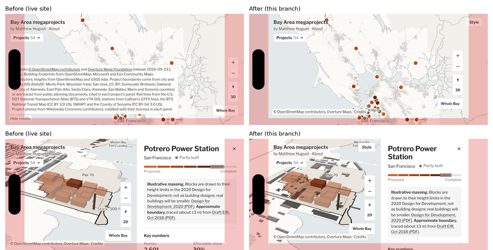
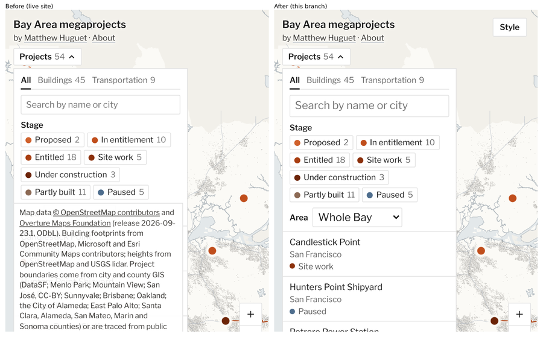

# Accessibility and speed check

Oct 12, 2026 (font subsetting added Oct 13). This checks the live site (https://matthew6113.github.io/BAM/, built from `main` at
`2b121f4`) on desktop and on an iPhone-sized screen. The fixes listed under "Fixed in this branch" are on
`claude/keen-clarke-vjavvt`, and the rest are open for Matthew's call. map.matthewhuguet.com can't be
reached from this environment, so the github.io address was tested instead (it's the same build).

## How it was tested

- **Browser.** Headless Chromium 141 with software WebGL (SwiftShader).
  - Desktop is a 1440 × 900 window.
  - "iPhone" is Chromium emulating an iPhone 15: 393 × 852 at 3×, touch, Safari's user agent. WebKit
    isn't installed here, so nothing ran in real Safari. Two iOS behaviors below come from Safari's
    documented behavior, not from observation: zooming into small form fields, and enlarging text in
    landscape.
  - Landscape safe areas were emulated with Chromium's safe-area override (59 px at the sides, 21 px at
    the bottom, as on an iPhone 15).
- **Accessibility.**
  - Lighthouse 12.8.
  - axe-core 4.10, set to WCAG 2.2 A and AA plus best practice. It ran on five states, on desktop and on
    the iPhone: home, Projects list open, Potrero panel after the fly-in, a transit panel and About.
  - A keyboard walk, reflow at 320 px wide, reduced motion, and touch-target and form-field sizes.
- **Speed.**
  - Lighthouse, mobile and desktop presets, three runs each; medians are reported.
  - Real throttled loads with Playwright. The iPhone profile slows the CPU 4×, on slow 4G (1.6 Mbps,
    150 ms) or fast 4G (9 Mbps, 60 ms).
  - Transfer sizes by type, layout-shift sources, and a CPU profile of the load and the fly-in.
- **Caveat.** Software WebGL compiles shaders and draws on the CPU. So Total Blocking Time, the Lighthouse
  performance score, the time until the map is drawn and fly-in frame rates are worse here than on a real
  phone or laptop. Byte counts, first paint, layout shifts and the order of requests are not affected. Frame rate needs a real iPhone
  (Safari Web Inspector → Timelines).

## At a glance

| | Desktop | iPhone |
|---|---|---|
| Lighthouse accessibility | 100 | 100 |
| axe violations, before → after this branch | 2 kinds → none | 1 kind → none (see note) |
| Lighthouse best practices / SEO | 100 / 100 | 96–100 / 100 |
| Lighthouse performance (median; see caveat) | 69 home, 66 project | 69 home, 49 project, 57 about |
| First text on screen | 0.7–0.8 s | 1.3 s on fast 4G, 4.1 s on slow 4G |
| Map drawn | 3.3–4.2 s | 3.1–4.0 s on fast 4G, 7.9 s on slow 4G |
| Downloaded for the first view | about 1.96 MB | about 1.09 MB |
| Layout shift (CLS) | 0.005 home, 0.03 deep link | 0.18 home (credits collapsing), 0.20 deep link |

On the iPhone, axe couldn't measure the list's contrast because the credits covered it (fix 7), so it
flagged only the landmark. The contrast miss is the same on both.

What the first view downloads (cold cache, compressed):

| | Desktop | iPhone |
|---|---|---|
| Script (one bundle) | 524 KB | 524 KB |
| Building and base tiles | 1,203 KB | 379 KB |
| Map label glyphs | 146 KB | 100 KB |
| UI font (Libre Franklin) | 71 KB (32 KB on this branch) | 71 KB (32 KB on this branch) |
| CSS | 14 KB | 14 KB |

Opening a project adds a few KB of massing, its photo (Potrero's is 133 KB), and, the first time, the
serif font used for the summary text: 428 KB on the live site, 72 KB on this branch (fix 8).

## What already works well

- **Keyboard.**
  - Tab order is logical: skip link, name, About, Projects, map, the map buttons, credits.
  - Every stop has a visible focus ring.
  - Opening a project moves focus to its heading. Escape closes the panel and returns focus to the
    control that opened it.
  - The map pans with the arrow keys and zooms with + and −.
  - The project tabs follow the ARIA tabs pattern (arrow keys, Home and End).
- **Screen readers.**
  - The map itself is a canvas, but the Projects list is a full equivalent: search, filters and every
    project.
  - The filter result is announced (`aria-live`), and the page title follows the open project.
  - Toggles use `aria-pressed` and `aria-expanded`, and the stage bar has a text label.
- **Reduced motion.** The fly-in becomes a jump cut, the buildings appear without rising, and the panel's
  slide-in animation is switched off.
- **Zoom and reflow.** Pinch zoom isn't disabled. At 320 px wide nothing scrolls sideways, and at 200%
  browser zoom the phone layout takes over cleanly.
- **Phones.** The map renders at no more than 2× pixel density on touch screens (sparing the GPU), hover
  tooltips are off on touch, and the bottom sheet already allowed for the home indicator.
- **Loading.** Massing and land use load per project, on demand. Photos are lazy-loaded with their sizes
  set, so they don't shift the panel.

## Fixed in this branch

1. **iPhone landscape: controls under the notch.**
   - The page runs edge to edge (`viewport-fit=cover`), but only the bottom sheet allowed for the
     iPhone's notch, rounded corners and home indicator. In landscape, the title, the Projects button,
     the map buttons, the credits and the panel's close button sat inside the unsafe area.
   - They now keep clear of it.
   - Nothing changes where the insets are zero, which is desktop, Android and an iPhone held upright in
     Safari. On desktop and on an upright iPhone, element positions match the live site.

   
   *Red is the unsafe area in iPhone 15 landscape and black the Dynamic Island. The Style button in the
   after shots belongs to the dev build.*

2. **iPhone: the page zoomed into the search box.**
   - Safari zooms the whole page into any form field set under 16 px when it takes focus. The search box
     was 13 px and the Area menu 12 px.
   - Here, the map captures pinch gestures, so zooming back out is awkward.
   - On touch screens both are now 16 px. That's the one visible change in this branch: the text in those
     two fields is larger on phones.
3. **iPhone landscape: enlarged text.** Safari enlarges text when a phone turns sideways unless the page
   opts out. The page now opts out (`text-size-adjust: 100%`). User zoom still works.
4. **Contrast.**
   - In the Projects list, the counts and the city names were 4.4:1 against white; text this size needs
     4.5:1.
   - They're now 66% ink instead of 60%: 5.4:1 on white and 4.8:1 on the hover tint. The difference is
     hard to see.
5. **Landmarks.** The credits sat outside any landmark, so screen-reader users navigating by landmark
   skipped them. They're now a `footer` (contentinfo).
6. **One map region, not two.** Screen readers announced a "Map of the Bay Area" region with a "Map"
   region inside it (MapLibre's canvas). Now there's one: the canvas, named "Map of the Bay Area".
7. **Credits covered the Projects list.**
   - For the first 5 seconds the credits are open. Opening Projects in that time put the credits box over
     the lower part of the list. On a phone, that hid the Area filter and the first projects.
   - Opening the list now collapses the credits, as dragging or zooming the map already did.

   
   *Opened within the first 5 seconds. After: the credits are out of the way, and the search box and
   Area menu are 16 px.*

8. **Web fonts cut to the characters the site shows.**
   - Both fonts shipped with every character they have and, for the serif, the full optical-size axis.
   - The web copies now keep Latin, Latin-1, Latin Extended-A, punctuation, arrows and a few symbols.
     The serif's optical size is fixed at 15.5, what browsers pick for the 15.5 px summaries, with weights
     400–700.
     - Libre Franklin drops from 72 to 32 KB. It loads on every visit.
     - The serif drops from 428 to 72 KB. It loads the first time a project opens.
   - The serif ships as **Megaprojects Serif**. Source Serif 4's own name records reserve the name
     "Source", and the OFL doesn't let a subset keep a Reserved Font Name (OFL FAQ 2.6). Its copyright,
     trademark and license records are kept, and the credits name Source Serif 4. Matthew chose this on
     Oct 13.
   - Compared with the live site, the summary text breaks at the same places and its line boxes are the
     same size. Pixels differ only in the antialiasing at glyph edges.
   - `tests/fonts.test.ts` fails if the data or the interface ever uses a character outside the subset.
   - Two side effects:
     - The share card's 24 px serif line will use the 15.5 optical size the next time it's redrawn
       (`npm run share-card`), so it will look a touch sturdier than the card now online.
     - The serif's map-label glyphs, used only if the style panel switches labels to the serif, are now
       "Megaprojects Serif Regular", "SemiBold" and "Italic".
   - Editing `pipeline/` makes CI rebuild all the map data once. Past rebuilds took 8–10 minutes; this one
     also downloads the Overture extract again, because `fonts.py` is part of that cache key too.

Checks after the fixes: type check, unit tests and the Playwright interaction tests pass; axe finds no
violations in any of the ten states.

## Open, for your call

Ranked by payoff, speed first.

### Speed

1. **A blank page until the script runs.**
   - The page is empty until the 524 KB bundle has downloaded and run: 4.1 s on slow 4G, 1.3 s on fast
     4G.
   - Writing the title and byline into `index.html` (and the generated project pages) would put words on
     screen in about a second, while the map loads.
2. **One large bundle.**
   - What's in it: MapLibre is about 300 KB of the 524 KB. The project data is about 220 KB:
     `projects.json` 116 KB, boundaries 82 KB, rail lines 21 KB.
   - Why it hurts repeat visits: GitHub Pages lets browsers cache files for only 10 minutes, and every
     deploy renames the single bundle. So a returning visitor downloads all of it again after each data
     update.
   - Splitting MapLibre into its own file keeps that file's name stable between deploys. The browser then
     revalidates it instead of downloading it again.
   - The `reported` records (23 KB, never shown) could also be dropped at build time.
3. **Regional building tiles.**
   - The "all" overview, chosen for the look, is about 1.2 MB for a 1440 × 900 first view and 380 KB on
     a phone.
   - The "light" variant trades density for size. This is a design call; listed only so the cost is known.
4. **Photo sizes.**
   - Photos are 1280 px JPEGs shown 380–400 px wide.
   - An 800 px version with `srcset` (and WebP) would save about 95 KB per panel on a phone.
   - Photos are lazy-loaded, so this doesn't touch first load.
5. **Layout shift.**
   - The credits collapsing after 5 s moves the credits block: 0.18 on a phone, where "good" is under
     0.1.
   - On a deep link, the map buttons and credits jump above the sheet as it opens (0.08).
   - Fixes: lay the credits text out of flow, so collapsing it moves nothing, and move the buttons with
     a transform.
   - This mostly affects the Core Web Vitals score, not what visitors notice.
6. **First fly-in compiles the 3D shaders.**
   - Here, 2.9 s of the fly-in's main-thread time is WebGL shader linking, done the first time the 3D
     layers draw.
   - A real GPU is much faster, but it's the likeliest cause of a hitch at the start of the first fly-in
     on an iPhone.
   - Worth timing on a real phone before changing anything.

### Accessibility

1. **Touch targets.**
   - Apple asks for 44 pt. The map buttons and the close button are 32 px, Projects 26, the tabs 25, the
     stage filters 22 and the credits toggle 19.
   - All of them pass WCAG 2.2 AA (24 px, or enough space around them), so this is comfort, not
     compliance.
   - Option: grow them to 44 px on touch screens only, which makes the button stack about 40% taller on a
     phone.
2. **Stage filters switched off.**
   - Their text is 45% ink, 3.0:1, below the 4.5:1 that text on a working control needs.
   - The strike-through and faded dot already show the state. 62% ink would pass (4.7:1) at the cost of
     a softer on/off difference.
3. **Small text on phones.**
   - Lighthouse's "legible font sizes" check flags the 11 px credits and button labels on a phone.
   - Most of that text is the credits paragraph, which collapses after 5 s.
4. **Palette swaps.**
   - The theme's contrast test covers stages, labels and the selection, but not the secondary text mixed
     from the panel ink (counts, cities, notes).
   - A new palette could push those under 4.5:1 without a test failing. Extending the test would catch
     it.

## Raw numbers

Lighthouse, medians of three runs:

| Preset, page | Performance | First paint | Largest paint | Blocking time | CLS | Speed index |
|---|---|---|---|---|---|---|
| Mobile, home | 69 (42–69) | 0.9 s | 1.4 s | 3.4 s | 0.081 | 3.0 s |
| Mobile, Potrero deep link | 49 (44–58) | 0.9 s | 3.5 s | 8.5 s | 0.196 | 4.4 s |
| Mobile, about | 57 (55–60) | 0.9 s | 3.9 s | 2.5 s | 0 | 4.8 s |
| Desktop, home | 69 (66–70) | 0.3 s | 0.4 s | 1.1 s | 0.005 | 1.7 s |
| Desktop, Potrero deep link | 66 (65–67) | 0.3 s | 0.7 s | 1.3 s | 0.028 | 2.1 s |

Lighthouse simulates slow 4G, but its first-paint estimate is too kind for this page: nothing can paint
before the script runs. The real throttled loads above are the better guide (4.1 s on slow 4G).

Main thread, desktop, software WebGL:

- **Load to first complete map.** 3.9 s sampled, of which 1.3 s is idle. About 1.8 s is MapLibre setting
  up WebGL programs; the app's own code is under 50 ms.
- **Fly-in.** 8.7 s sampled, of which 4.8 s is idle and 2.9 s is shader linking.
