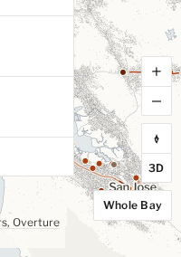
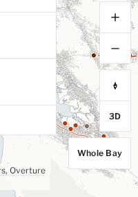
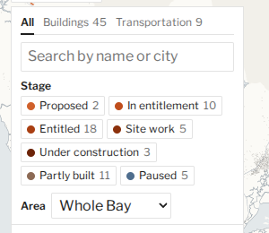
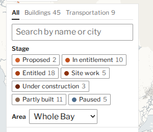
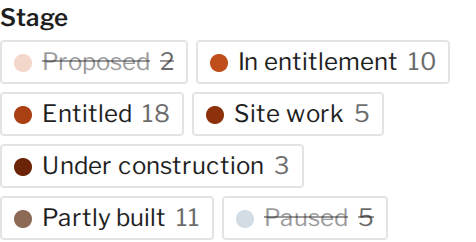
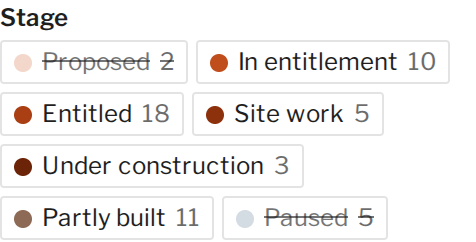

# Phone, accessibility and speed check (October 2026)

Oct 16, 2026. This checks the whole map now that it has 54 projects, photos, the Buildings and
Transportation tabs and the about page. It follows on from the Oct 12 check
(`docs/ACCESSIBILITY-SPEED-AUDIT.md`) and closes several of the items that check left open. Everything
was tested locally against the real tiles (dev server and a production build); the live site can't be
reached from this environment.

## How it was tested

- **Phone.** WebKit isn't installed here, so "iPhone" is Chromium (SwiftShader WebGL) with Playwright's
  iPhone 13 profile: a 390 × 664 viewport (an 844 px screen, less Safari's bars) at 3×, touch, the mobile
  Safari user agent. Landscape is 844 × 390. The notch was simulated by setting the page's safe-area
  variables to an iPhone's insets (47 px at the sides and 21 px at the bottom in landscape; 47 px at the
  top and 34 px at the bottom upright).
  - The walk: landing, open Projects, switch tabs, search, open a project (the fly-in), scroll the bottom
    sheet to the photo and the sources, next and previous, close, About, a deep link to
    `/p/treasure-island`, then landscape (project, list, About).
  - At each step a script measured tap targets under 44 px, text under 12 px, sideways scrolling, pinned
    pieces cut off at the screen edge, and pinned pieces overlapping each other.
- **Accessibility.**
  - axe-core 4.14 (via `@axe-core/playwright` 4.14.0, newly added as a devDependency), WCAG 2.2 A and AA
    plus best practice. It ran on six states at desktop (1280 × 800) and phone size: landing, the list
    open, the Transportation tab, Potrero's panel (which has a photo), a rail line's panel, and About.
  - A keyboard-only walk: tab order, visible focus, whether a focused control is hidden behind
    something, Escape, and where focus goes afterwards.
  - Landmarks and headings, names on icon buttons, alt text, and reduced motion.
  - Contrast worked out by hand for every muted text tone in `src/styles.css`.
- **Speed.** A production build, served by a small local server that compresses like GitHub Pages (gzip
  for text, byte ranges for tiles). Cold cache, iPhone profile, Chrome DevTools' "Fast 3G" (1.44 Mbps
  down, 562 ms round trip) and 4× CPU slowdown through the Chrome DevTools Protocol. Three runs per
  build; medians are reported.
  - Software WebGL draws on the CPU, so "map ready" and fly-in times are slower here than on a real
    phone. Bytes, request order and before/after differences are still reliable.

## Results at a glance

| | Before | After |
|---|---|---|
| axe, serious or critical violations (12 states) | 0 | 0 (now checked by `tests/a11y.spec.ts`) |
| Keyboard focus hidden behind other UI | 2 places | 0 |
| Escape in the Projects list | did nothing | closes it, focus back on the toggle |
| Focus after closing a deep-linked project | lost (page body) | the map |
| Text under 12 px on a phone | map buttons, credits, stage-bar ends, number labels, list notes | none |
| Muted text under 4.5:1 | stage filters switched off (2.8:1) | none; a test now checks every tone |
| Main app script, compressed | 264.5 KB | 225.5 KB (−15%) |
| Map ready on the home page, Fast 3G and 4× CPU | 9.48 s | 9.17 s |
| Deep link to Potrero: fly-in starts / buildings risen | 10.43 s / 17.72 s | 9.88 s / 16.85 s |

## Findings

Severity: **high** blocks a task or fails WCAG AA; **medium** is a WCAG AA risk or a real annoyance;
**low** is comfort or polish.

| # | Area | Issue | Severity | Status |
|---|---|---|---|---|
| 1 | Keyboard, phone | The open Projects list ran under the credits line at the bottom of the screen: the last rows couldn't be tapped, and keyboard focus went to rows the credits covered. | Medium | Fixed |
| 2 | Keyboard | Escape inside the open Projects list did nothing. | Medium | Fixed |
| 3 | Keyboard | Closing a project opened from a deep link (or a shared link) left focus on the page body, so the next Tab started again from the top. | Medium | Fixed |
| 4 | Keyboard, phone | With About open on a phone, the map buttons and credits sat behind the sheet but stayed in the tab order, so focus went out of sight (WCAG 2.4.11). | Medium | Fixed |
| 5 | Contrast | Stage filters switched off were 45% ink, 2.8:1 (text on a working control needs 4.5:1). | Medium | Fixed: 62% ink, 4.7:1 (see screenshot) |
| 6 | Contrast, tests | The contrast tests covered map colors only, not the interface's muted text (tabs, About notes, photo credits, counts). A new palette could break them unnoticed. | Medium | Fixed: test reads every tone from the stylesheet |
| 7 | Phone | Text under 12 px: map button labels and credits (11 px), stage-bar ends (11 px), key-number labels and list notes (11.5 px). | Low | Fixed: 12 px (a barely visible change) |
| 8 | Phone | Tap targets under 44 px: the close buttons were 32 px; Projects, credits and next/previous 19–30 px tall. | Low | Fixed without a visible change: close buttons are 44 px, the others get a larger invisible touch area |
| 9 | Phone | The map buttons are 32 px; stacked, they can only grow sideways invisibly (to 44 × 32). Tabs (25 px) and stage filters (22 px) are tightly packed. All pass WCAG 2.2 AA (24 px or enough spacing). | Low | Proposal A |
| 10 | Phone, landscape | With a notch, the 12 px credits line beside the side panel ran into the Whole Bay button. | Low | Fixed: the credits allow for the panel's width |
| 11 | Landmarks | No `main` landmark: screen-reader users couldn't jump to the map. | Low | Fixed: the map and its buttons are in `main` |
| 12 | Contrast (non-text) | The search box, Area menu and stage filters are outlined in the rule color, 1.3:1 on white; WCAG 1.4.11 asks 3:1 for a control's boundary (the placeholder and labels help, but don't replace it). | Medium | Proposal B |
| 13 | Contrast | The title and byline sit on the map with a paper halo. Over dense 3D buildings (a project fly-in on desktop) the byline links get hard to read. axe can't measure text over a canvas, so it lists them as "needs review". | Low | Proposal C |
| 14 | Photos | The alt text and the caption are the same sentence, so screen readers read it twice. | Low | Proposal D |
| 15 | Speed | The main script carried the traced GeoJSON with its pretty-printing (about half of it whitespace) and project fields the app never reads, including each project's `reported` record (press-only facts the map never shows). | Medium | Fixed: about 39 KB compressed off every first visit |
| 16 | Speed | A deep link waited for the map to load before fetching the project's massing (one more round trip, about 0.6 s on 3G). | Low | Fixed: fetched while the map loads |
| 17 | Speed | The panel photo (Potrero's is 130 KB) loads during the fly-in on a phone, since the sheet is within the browser's lazy-load distance, and it competes with the building tiles. | Low | Fixed: `fetchpriority="low"`; still `loading="lazy"` |
| 18 | Speed | The first view fetches the header (16 KB each, one round trip) of all five tile files, including the z13–z15 buildings, which aren't drawn until you zoom in. | Low | Proposal E |
| 19 | Speed | The regional "all" overview tile is the biggest single download on a phone (250 KB). | Low | Proposal F (already raised Oct 12; a design call) |
| 20 | Speed | Photos are 1200 px wide (41–380 KB, 207 KB on average) and shown at most 400 px wide. | Low | Proposal G (raised Oct 12) |

### What already works

- No sideways scrolling anywhere, upright or landscape. Nothing is cut off at the screen edges, and the
  notch insets are respected in both orientations.
- The bottom sheet scrolls on its own (`overscroll-behavior: contain`) and doesn't trap the page. The map
  above it still pans, and the site stays in view above the sheet.
- Controls stay reachable: on a phone they move above the sheet when a project is open.
- Every icon button has a name ("Zoom in", "Reset north", "Close and fly back", "Close about"). The tabs
  follow the ARIA tabs pattern, and the filters use `aria-pressed`.
- Focus moves to the panel heading on open, and to the new project's heading on next or previous.
  Escape closes the topmost thing; focus returns to whatever opened it.
- Reduced motion: the fly-in is a dip to paper and a jump (one camera move), buildings appear without
  rising, the panel doesn't slide in, and the map buttons and Whole Bay move instantly.
- Photos have alt text and a credit with license and source, use `loading="lazy"` with their size set,
  and only the open project's photo is downloaded (checked by a test).
- Massing and land use load per project, on demand. Every tile file is under 100 MB (the largest,
  `buildings-overview-all.pmtiles`, is 80 MB).

## What changed (fixes)

- `src/App.tsx`
  - The map and its controls are inside `<main>`.
  - Closing a project with no opener (a deep link) puts focus on the map instead of the page body.
  - On a deep link, the project's massing and land use start downloading while the map loads.
- `src/ui/ProjectIndex.tsx`: Escape inside the open list closes it and returns focus to the Projects
  button. It stops there, so a second Escape closes an open project as before.
- `src/ui/ProjectPanel.tsx`: the photo has `fetchpriority="low"`.
- `src/styles.css`
  - The open Projects list ends above the credits line, and the title block sits above the credits.
  - Text at least 12 px: map buttons, credits, stage-bar ends, number labels, list notes.
  - Stage filters switched off are 62% ink instead of 45%.
  - Close buttons are 44 px targets, with the icon in the same place.
  - On touch screens, the map buttons, Projects, credits and next/previous get a larger invisible touch
    area.
  - On a phone, the controls and credits behind the About sheet are hidden, which takes them out of
    the tab order.
  - Beside a side panel, the credits keep clear of the controls.
- `scripts/clientData.ts` (new, in `vite.config.ts`): strips whitespace from the bundled GeoJSON (the
  geometry is identical) and leaves out the project fields the app never reads (`massingNotes`,
  `acresNote`, `nextMilestone`). Each `reported` record becomes `true`, so the panel still says that
  reported details are held back. `data/projects.json` and the GeoJSON files are unchanged, and Vitest
  reads them untouched.
- Tests
  - `tests/a11y.spec.ts` (new, part of `npm run e2e`):
    - axe finds no serious or critical violations on landing, the open list, the Transportation tab,
      Potrero's panel and About, at desktop and phone size;
    - `main` holds the map and its controls;
    - Escape closes the list and focus returns to its toggle;
    - focus lands on the map after a deep-linked project closes;
    - reduced motion jumps (at most two camera moves) and the panel doesn't slide in;
    - photos load only for the open project, lazily, with alt text and a credit;
    - on a phone: no sideways scroll, the list stays clear of the credits, the close button is 44 px,
      and the controls behind the About sheet are hidden.
  - `tests/theme.test.ts`: every muted text tone in the stylesheet (panel ink mixed toward transparent)
    must reach 4.5:1 on the panel. Paused and distressed labels in their stage color must too, and so
    must labels on land. With the old 45% filter tone, the test fails.
  - `tests/clientData.test.ts` (new): only fields the app never reads are left out (it fails if `src/`
    starts reading one), `reported` survives as a flag, and everything else is unchanged.
- `package.json`: `@axe-core/playwright` 4.14.0 (dev only), and the e2e script includes the new spec.

## Proposals (changes to the look, for Matthew's call)

Matthew chose A, B and D on Oct 16, and they're now done:
- **A:** on touch screens the map buttons are 44 px, with 16 px icons
  ([screenshot](screenshots/audit/done-a-controls-44px.png)).
- **B:** a new theme role, `controlBorder` (#949494, 3.0:1 on the panel), outlines the search box, Area
  menu, stage filters and the suggestion form's fields ([screenshot](screenshots/audit/done-b-outlines.png)).
  `tests/theme.test.ts` checks it stays at 3:1.
- **D:** photos have `alt=""`. The caption below each one already says what it shows, so screen
  readers now read it once.

C, E, F and G are still open.

**A. 44 px map buttons on touch screens.** Low. The stack grows about 40% taller on a phone. The
invisible touch area already widens them to 44 px.

| Now | 44 px |
|---|---|
|  |  |

**B. 3:1 outlines on the search box, Area menu and stage filters.** Medium (WCAG 1.4.11). It needs a
theme role, such as `controlBorder`, so the palette swap stays a one-file change. The mock-up uses
#949494 (3.0:1).

| Now | 3:1 outline |
|---|---|
|  |  |

**C. A paper backing behind the title and byline in 3D views.** Low. The byline over dense buildings is
the hardest text on the page to read (top left of
[desktop-project-after.png](screenshots/audit/desktop-project-after.png)). Options are a solid paper
plate like the Projects button's, or a stronger halo.

**D. Photo alt text distinct from the caption.** Low. Either `alt=""` (the caption describes the photo)
or a short visual description in `data/photos.json`. That file wasn't touched in this pass.

**E. Fetch the z13–z15 building tile headers when first needed.** Low. This saves 48 KB and a round
trip from the first view, about 0.3 s on 3G. It needs those sources added lazily in `src/map/style.ts`.

**F. The "light" regional overview on slow connections or phones.** Low (raised Oct 12). It's a design
call.

**G. 800 px photos with `srcset`.** Low (raised Oct 12). It would save about 100 KB per panel opened.
`make photos` would produce them.

Also seen, not changed: the stage-filter change (finding 5) softens the on/off difference a little.
That trade-off was left to Matthew on Oct 12, but it's an AA failure, so it's fixed here. It's one line
in `styles.css` if he prefers another way to show the state (for example, a bolder strike).

*Before (45% ink, 2.8:1), then after (62%, 4.7:1).*

## Speed numbers

Production build sizes (Vite's own report):

| File | Before | After |
|---|---|---|
| App script `index-*.js` | 1,128 KB, 264.5 KB gzip | 757 KB, 225.5 KB gzip |
| MapLibre `maplibre-*.js` | 1,016 KB, 274.6 KB gzip | unchanged |
| MapLibre worker | 510 KB | unchanged |
| CSS (app and MapLibre) | 19.3 + 83.0 KB, 4.0 + 10.7 KB gzip | 20.0 + 83.0 KB, 4.2 + 10.7 KB gzip |
| Largest massing chunk (Mare Island) | 209 KB | 94 KB |
| Potrero massing chunk | 25.7 KB | 16.3 KB |
| All JS assets | 9.2 MB | 7.8 MB |

The home page's first view, iPhone profile, cold cache, Fast 3G and 4× CPU (medians of three):

| | Before | After |
|---|---|---|
| First text on screen | 1.72 s | 1.71 s |
| Map ready | 9.48 s | 9.17 s |
| Requests | 19 | 19 |
| Downloaded | 1,089 KB | 1,050 KB |
| JS, compressed on the wire | 522 KB | 483 KB |

What the 1,050 KB is: MapLibre 266 KB, the app 216 KB, tiles 379 KB (the regional overview tile is
250 KB of that), label glyphs 101 KB, Libre Franklin 71 KB, CSS 14 KB. No photo, massing or land-use
request is made on the home page.

Deep link to Potrero, the same profile (full motion, from the first byte):

| | Before | After |
|---|---|---|
| Fly-in starts | 10.43 s | 9.88 s |
| Buildings risen | 17.72 s | 16.85 s |
| Downloaded in all | about 1.39 MB | about 1.35 MB |

Without throttling, the home page's map is ready in about 1.6 s here.

Where the time goes on 3G: the two scripts arrive at about 4.4 s, limited by bandwidth (they're half of
the first view's bytes). MapLibre then sets up and fetches the five tile headers (about 1 s), and the
glyphs and tiles follow. The remaining wins are in proposals E and F, and a smaller app script. The
next big piece of that script is the 494 KB of boundaries, now 256 KB minified, which the regional view
needs at once.

## Screenshots

All in `docs/screenshots/audit/`, taken after the fixes (iPhone 13 profile, at 1× CSS pixels):

- Upright: `phone-01-landing`, `phone-02-index`, `phone-03-tab-transport`, `phone-05-project`,
  `phone-06-photo`, `phone-07-sources`, `phone-08-prev-next`, `phone-11-about`, `phone-13-deeplink`
  (Treasure Island), and `phone-18-portrait-safe-area`.
- Landscape: `phone-14-landscape-project`, `phone-15-landscape-index` and
  `phone-17-landscape-safe-area`.
- Desktop: `desktop-project-after` (1440 × 900).
- Proposals: `proposal-a-*` and `proposal-b-*`. The stage filters: `stage-filter-off-before` and
  `-after`.

## Checks

- `npx tsc --noEmit`: passes.
- `npm test`: 469 tests pass (one file skipped, as on `main`).
- `npm run e2e`: 34 tests pass, 14 of them new.
