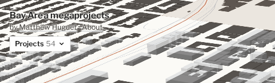
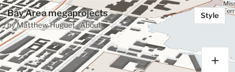
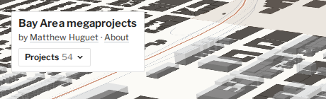
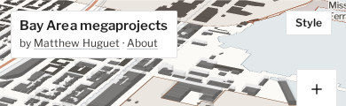
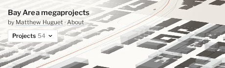
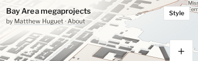
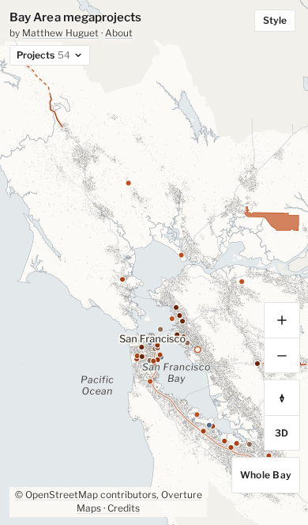
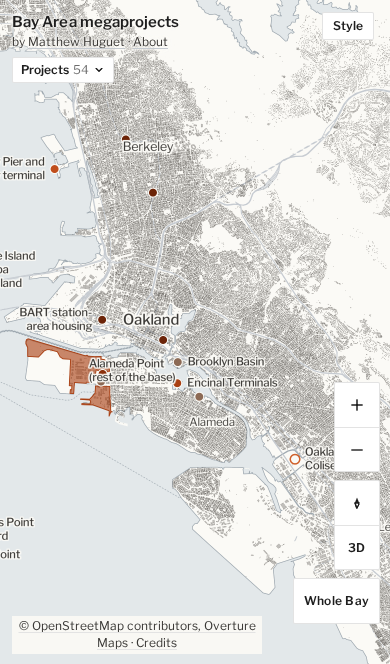
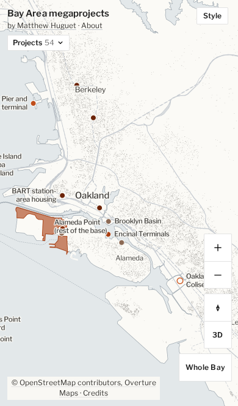

# Options C and F (October 2026 audit), for Matthew

**Decided Oct 17, 2026: the fade (C2), shown only with a project open, and F kept as is.** The
`applied-fade-*` shots show the result on the regional and project views.

Both change the look, so neither was applied before Matthew chose. Screenshots are from the dev build on Oct 17, 2026
(headless Chromium with SwiftShader; iPhone 13 profile for the phone shots).

## C. The title over dense 3D buildings

On a landed project view, the byline links ("Matthew Huguet · About") are hard to read over the
building print. Desktop shots are the top-left 460 × 140 px; phone shots the top 390 × 120 px.

| | Desktop | Phone |
|---|---|---|
| **Now**: paper halo only |  |  |
| **1. Plate**: a white panel like the Projects button's, holding the title, byline and Projects |  |  |
| **2. Fade**: a soft paper wash from the corner, no edge |  |  |

A stronger text halo and a solid outline around the letters were also tried; neither read
differently from now in Chromium, so they aren't shown.

## F. A lighter regional overview on phones

The map ships two overview tile sets (`?overview=all`, the default, and `?overview=light`). They look
alike at the whole-Bay view; the difference is at middle zooms, between the whole Bay and street level.

| | All buildings (now) | Light |
|---|---|---|
| Whole Bay |  |  |
| East Bay, zoom 10.5 |  |  |

Overview tiles downloaded for the East Bay view: about 1,570 KB with all buildings, 77 KB with the light
set. At the whole-Bay view the two were within noise (266 and 308 KB in one run).

The light set loses the "map of every building" print at middle zooms, which is the look the map is
built on, so the trade is a much smaller download on phones against that texture.
